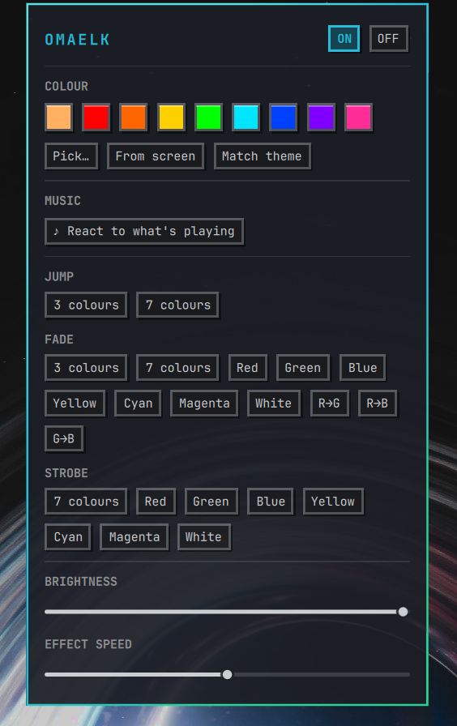
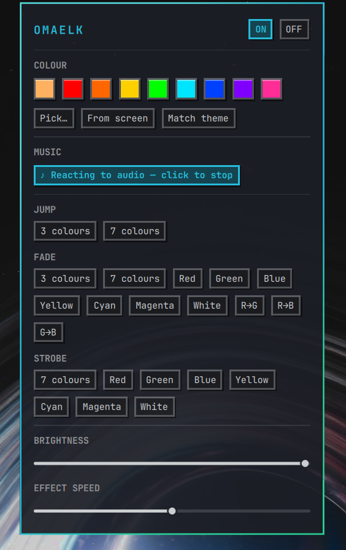

<p align="center">
  
</p>

<h1 align="center">OmaElk</h1>

<p align="center">
  An <a href="https://omarchy.org">Omarchy</a> plugin for cheap <b>ELK-BLEDOB / ELK-BLE</b> Bluetooth LED lights —<br>
  colours, effects, brightness and a <b>music-reactive mode</b>, from a pixel-art bar widget or the shell.
</p>

<p align="center">
  
</p>

These controllers (the little box on a USB-powered RGB strip, advertising as
`ELK-BLEDOB`) are powered over USB but **controlled over Bluetooth LE**, so they
never show up in `lsusb`. OmaElk talks to them directly; no phone app needed.

**Any standard Bluetooth LE adapter will do** — the one built into your laptop
or a cheap USB dongle — as long as it can reach the controller. There is nothing
adapter-specific to install or configure.

## Features

- **Bar widget** — a pixel-art bulb that takes its colour from your Omarchy
  theme. Click for a popup with swatches, effects, brightness and speed.
  Right-click toggles music mode (three music notes come off the bulb while it
  is on), middle-click matches the current theme.
- **22 built-in effects** — jump, fade (single colours and cross-fades), strobe.
- **Music-reactive mode** — follows whatever you are playing. Hue tracks the
  spectrum (bass → red, treble → violet), brightness tracks loudness, with a
  punch on the beat.
- **Colour pickers** — a colour dialog and a screen eyedropper.
- **Theme sync** — match the lights to your Omarchy theme's accent colour, on
  demand or automatically on every theme change.
- **Fast and light** — one background process holds the Bluetooth link; once it
  is connected, commands take ~50 ms (the first connect takes a few seconds).
  See [Performance](#performance).
- **`omaelk` CLI** — scriptable, with a menu generator for the Omarchy launcher.

<table>
  <tr>
    <td align="center"><br><sub>The popup</sub></td>
    <td align="center"><br><sub>Music mode on</sub></td>
  </tr>
  <tr>
    <td colspan="2" align="center"><br><sub>In music mode three notes come off the bulb</sub></td>
  </tr>
</table>

## Install (Omarchy plugin)

> Omarchy plugins run as ordinary, **unsandboxed** code inside your shell. Read
> what you install; this one is small and MIT-licensed.

**1. Add the plugin and enable it**

```bash
omarchy plugin add https://github.com/paulorivera27/omaelk.git --enable
```

`omarchy plugin add` clones the repo into
`~/.config/omarchy/plugins/paulorivera27.omaelk/`, validates its `manifest.json`,
and asks you to confirm (pass `--yes` to skip that). With `--enable` it also
turns the plugin on and asks which bar section to put the widget in, suggesting
`right`, the section this plugin's manifest asks for. Without `--enable` it
installs disabled; enable it later, choosing the section yourself:

```bash
omarchy plugin enable paulorivera27.omaelk --section right
```

**2. Put it where you want it in the bar** (optional)

```bash
omarchy bar put  paulorivera27.omaelk --section right          # add it
omarchy bar move paulorivera27.omaelk --section left --index 0 # reposition
omarchy bar put  paulorivera27.omaelk --after omarchy.clock    # next to the clock
```

**3. Find your controller (once)**

Plug the lights into USB power, close any phone app that is connected to them
(a connected controller stops advertising), then:

```bash
~/.config/omarchy/plugins/paulorivera27.omaelk/omaelk setup
```

The first run builds a small Python virtualenv in `~/.local/share/omaelk/venv`
(installs `bleak` and `numpy`; needs `python3` with `venv` and network access
once). `setup` scans for the controller and remembers its address. After that the
bar icon works.

**Manage the plugin**

```bash
omarchy plugin list                          # see it and its state
omarchy plugin update paulorivera27.omaelk   # pull the latest (shows a diff first)
omarchy plugin disable paulorivera27.omaelk  # turn it off, keep it installed
omarchy plugin remove paulorivera27.omaelk   # uninstall
```

Removing the plugin leaves its virtualenv and config behind. To wipe those too:

```bash
~/.config/omarchy/plugins/paulorivera27.omaelk/omaelk stop-daemon   # before removing
rm -rf ~/.local/share/omaelk ~/.config/omaelk
```

### Requirements

| | |
|---|---|
| Linux with BlueZ and any Bluetooth LE adapter | one that can reach the controller |
| `python3` + `venv` | everything else is installed for you |
| `pipewire-pulse` / `pulseaudio-utils` | `parec`, for music mode |
| `zenity`, `hyprpicker` | optional: colour dialog / eyedropper |

Tested with an `ELK-BLEDOB` controller on Omarchy (Arch, Hyprland, PipeWire).
Other `ELK-BLE*` controllers that speak the same protocol should work; see
[Compatibility](#compatibility).

### CLI only (without the plugin)

```bash
git clone https://github.com/paulorivera27/omaelk.git
cd omaelk
./omaelk setup
ln -s "$PWD/omaelk" ~/.local/bin/omaelk     # optional: run `omaelk` anywhere
```

## Usage

```bash
omaelk setup                       # discover the controller (once)
omaelk on / omaelk off
omaelk color ff8800                # any RRGGBB hex
omaelk bright 60                   # 0-100
omaelk mode fade-7color            # built-in effect, see below
omaelk mode strobe-red --speed 80
omaelk speed 40                    # effect speed 0 (slow) .. 100 (fast)
omaelk music                       # react to what's playing; Ctrl-C to stop
omaelk music-stop / omaelk music-status
omaelk status                      # link + last-commanded power, e.g. "connected on";
                                   # never starts the daemon
omaelk scan-modes                  # step through every effect to see them
omaelk menu-snippet                # entries for the Omarchy launcher menu
```

Setting a colour or effect, or turning the lights off, while music mode is
running stops music mode, so the change sticks.

### Effects

| | |
|---|---|
| `jump-3color` `jump-7color` | hard jumps between colours |
| `fade-3color` `fade-7color` | smooth cross-fade |
| `fade-red` `fade-green` `fade-blue` `fade-yellow` `fade-cyan` `fade-magenta` `fade-white` | pulse one colour |
| `fade-red-green` `fade-red-blue` `fade-green-blue` | cross-fade two colours |
| `strobe-7color` `strobe-red` `strobe-green` `strobe-blue` `strobe-yellow` `strobe-cyan` `strobe-magenta` `strobe-white` | strobe |

### Omarchy launcher menu

The bar widget is the main interface, but you can also have an **OmaElk**
submenu in the Omarchy launcher (colours, grouped effects, speed, brightness):

```bash
omaelk menu-snippet
```

prints JSONC rows, with this install's real paths, to paste into
`~/.config/omarchy/extensions/omarchy-menu.jsonc` (before the closing `}`). To
open it from a key, add to `~/.config/hypr/bindings.lua`:

```lua
o.bind("SUPER + SHIFT + L", "OmaElk", "omarchy-menu summon omaelk")
```

### Match the theme automatically

`scripts/theme-sync.sh` pushes the active theme's accent colour to the lights.
To run it on every theme change:

```bash
omarchy hook install theme-set ~/.config/omarchy/plugins/paulorivera27.omaelk/scripts/theme-sync.sh
```

`omarchy hook install` *copies* the script into
`~/.config/omarchy/hooks/theme-set.d/`; the copy finds OmaElk at its standard
plugin location (or wherever `OMAELK_HOME` points). If you move or rename the
plugin, or update `theme-sync.sh`, run the install command again. To remove the
hook, delete `~/.config/omarchy/hooks/theme-set.d/theme-sync.sh`.

## Music mode and privacy

Music mode listens to the **monitor of your default audio output** (a copy of
what you are already playing) using `parec`. It is not your microphone. Each
~43 ms frame is analysed with an FFT and then discarded: **nothing is recorded,
saved or sent anywhere**. The only thing that ever reaches the light is three
colour bytes. `omaelk music --source NAME` picks a different monitor; list them
with `pactl list short sources | grep monitor`.

## Configuration

| | |
|---|---|
| `omaelk setup` | saves the controller address to `~/.config/omaelk/config.json` |
| `OMAELK_ADDR` | override the controller address |
| `OMAELK_VENV` | override the virtualenv location |
| `--addr AA:BB:..` | per-command address override |

With no address configured, the daemon scans for the first `ELK-BLE*` device
and remembers it.

## How it works

```
 omaelk CLI / bar widget / menu ──►  Unix socket  ──►  daemon  ══ BLE ══►  controller
      (instant, stateless)         $XDG_RUNTIME_DIR   (one connection,
                                    /omaelk.sock       single instance)
```

Scanning and connecting over BlueZ takes seconds, and a controller that is
already connected stops advertising — so doing it per command made rapid changes
hang or get dropped. Instead a small daemon owns the single connection and every
command is a one-line write to its socket. The daemon:

- starts on demand and is guarded by a lock, so simultaneous clients can never
  spawn two daemons that fight over the link;
- opens its socket before connecting, so a missing controller never makes the
  CLI hang — it reports a clear error and backs off for a few seconds;
- remembers the last power it was told to set, since the controller can't be
  asked (that is what `omaelk status` and the bulb's dimming read);
- recovers a stuck BlueZ link (`bluetoothctl disconnect`, then rescan) on its own.

### Protocol

GATT service `0xfff0`, write characteristic `0xfff3` (write-without-response).
Commands are 9-byte frames `7E <7 bytes> EF`:

| Action | Frame |
|---|---|
| Power on / off | `7E 07 04 FF 00 01 02 01 EF` / `7E 07 04 00 00 00 02 01 EF` |
| Colour | `7E 07 05 03 RR GG BB 10 EF` |
| Brightness | `7E 04 01 PP 01 FF 02 01 EF` (PP = 0–100) |
| Effect | `7E 07 03 <id> 03 FF FF 00 EF` (id `0x87`–`0x9C`) |
| Effect speed | `7E 07 02 <0–100> FF FF FF 00 EF` |

The controller accepts roughly 10–20 writes per second, which is why music mode
is capped at 15 and only sends when the colour actually changes.

## Performance

Measured on a 16-core machine while music mode was driven by a synthetic
bass-and-sweep track:

| | CPU (of one core) | Memory |
|---|---|---|
| `omaelk music` (capture + FFT + colour) | ~1.4 % | 37 MB |
| daemon, streaming colour | ~0.4 % | 28 MB |
| daemon, idle | 0.00 % | 28 MB, 1 thread |
| a plain `omaelk color …` call (link up) | ~50 ms wall | — |

That is about 0.1 % of the whole machine. The daemon idles at zero, the CLI does
not import NumPy unless you start music mode, and NumPy's thread pool is capped
to one thread. The only thing that polls is the bar widget: every 4 s it runs a
one-line shell command to see whether music mode is running (so a start or stop
from the menu or the CLI shows on the icon), and it asks the daemon for the
lights' power only while its popup is open.

## What the widget shows

- **The bulb** dims when the lights are off, and three music notes come off it
  (pulsing, in place of the rays) while music mode is on. Both come from real
  state, not from the last click: music from the
  music process itself, power from the daemon's last-commanded state
  (`omaelk status` prints `connected on` / `connected off` / `connected unknown`).
  The controller can't be asked whether it is on, so after the daemon restarts
  the power is `unknown` and the icon is left as it is until the next command.
- Music is re-checked every few seconds, wherever it was started from. Power is
  only re-checked while the popup is open, so a power change made from the CLI
  or the menu shows up the next time you open it. A command that has to
  reconnect first (up to ~20 s) is waited for rather than assumed.
- **Known limitations:** the highlighted colour or effect is the last one picked
  in the popup, and the brightness and speed sliders only send values. They stay
  where you leave them while the shell runs, but start at 100 and 50 after a
  restart: the controller doesn't report them, so they are not read back.

## Compatibility

Written against `ELK-BLEDOB`. The related `ELK-BLEDOM` family uses a slightly
different frame layout and is **not** covered; see the projects in
[Credits](#credits) for those. If your controller advertises as `ELK-BLE…` and
the colour command does nothing, it is probably a variant — open an issue with
the output of `omaelk setup`.

## Troubleshooting

- **"controller not found"** — is the USB power plugged in and the controller
  nearby? Close the phone app (a connected controller stops advertising).
- **Several Bluetooth adapters** — make sure the one in range of the controller
  is the one BlueZ is using: `bluetoothctl list`, then `bluetoothctl select <address>`.
- **The first command takes 10–20 s** — the daemon has to find and connect to the
  controller after it (re)starts; opening the popup starts that connecting.
  Once it is connected, commands take ~50 ms.
- **Stuck connection** — `bluetoothctl disconnect <address>`, then retry. The
  daemon also does this on its own after a failed scan.
- **Restart the daemon** — `omaelk stop-daemon` (the next command starts it again).
- **Music mode does nothing** — check `omaelk status`, and that audio is playing
  on the *default* output. `pactl get-default-sink` shows which.
- **Widget missing or blank** — `omarchy plugin list` should show
  `paulorivera27.omaelk` as `enabled`. QML errors land in the shell log:
  `qs -p /usr/share/omarchy/shell log -t 80` (a QML change needs
  `omarchy restart shell` to take effect).

## Development and publishing

```
manifest.json  BarWidget.qml  Panel.qml  PixelButton.qml   Omarchy plugin (QML)
CHANGELOG.md                                               release notes
assets/icon.svg                                            pixel-art icon
assets/screenshots/                                        README images
omaelk                                                     wrapper (venv bootstrap)
backend/       elk.py  daemon.py  client.py  cli.py  music.py
scripts/       theme-sync.sh  pick-color.sh  eyedropper.sh  music-toggle.sh
tests/         test_protocol.py
```

Omarchy turns Quickshell's own reloading off, so a change to a `.qml` file only
shows up after `omarchy restart shell`. A change to the Python backend is picked
up the next time the daemon starts (`omaelk stop-daemon`).

```bash
python3 -m unittest discover -s tests -v   # protocol + packaging checks
omarchy plugin validate .                  # Omarchy's own plugin validator
```

**The manifest.** `manifest.json` must sit at the repo root. Required fields:
`schemaVersion` (the number `1`), `id`, `name`, `version`, `kinds`, and
`entryPoints`. This plugin is a `bar-widget` whose `entryPoints.barWidget` is
`BarWidget.qml`. The `id` follows the `author.name` convention
(`paulorivera27.omaelk`); the `omarchy.*` namespace is reserved. The installer
rejects absolute or `..` entry paths and **any symlink inside the plugin folder**
(which is why the virtualenv lives outside it, in `~/.local/share/omaelk`).

**Publishing.** There is no central plugin registry: people install straight
from your git URL.

```bash
omarchy plugin validate .
gh repo create omaelk --public --source . --push     # first time
gh repo edit --add-topic omarchy --add-topic omarchy-plugin --add-topic led
git tag v0.3.0 && git push --tags                    # bump "version" in manifest.json first
```

Users then run `omarchy plugin add https://github.com/<you>/omaelk.git --enable`,
and `omarchy plugin update` follows your default branch.

The icon is a 16×16 bitmap drawn in `BarWidget.qml`; `assets/icon.svg` is the
same grid. The bar draws it in your theme's accent colour.

## Credits

This project stands on other people's reverse-engineering work. Thank you:

- **[8none1/elk-bledob](https://github.com/8none1/elk-bledob)** by **Will Cooke**
  (MIT) — the ELK-BLEDOB protocol this project implements: command frames and
  the full effect table. See [THIRD_PARTY.md](THIRD_PARTY.md).
- **[dave-code-ruiz/elkbledom](https://github.com/dave-code-ruiz/elkbledom)**
  (MIT) — the Home Assistant integration for the wider ELK-BLE* family; a
  reference for device discovery and how these controllers behave.
- **[FergusInLondon/ELK-BLEDOM](https://github.com/FergusInLondon/ELK-BLEDOM)**
  — protocol documentation for the ELK-BLEDOM controllers, used to understand the
  frame layout. (No code from it is used.)
- **[bleak](https://github.com/hbldh/bleak)** by Henrik Blidh — Bluetooth LE for
  Python.
- **[NumPy](https://numpy.org)** — the FFT behind music mode.
- **[Omarchy](https://omarchy.org)** by DHH — the desktop this plugin is built
  for — and **[Quickshell](https://quickshell.org)**, which powers its shell.
- **BlueZ**, **PipeWire**, **zenity** and **hyprpicker**.

## License

[MIT](LICENSE) © 2026 Paulo Rivera. Third-party notices are in
[THIRD_PARTY.md](THIRD_PARTY.md).
